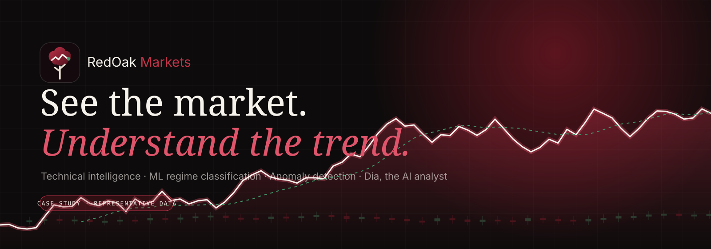
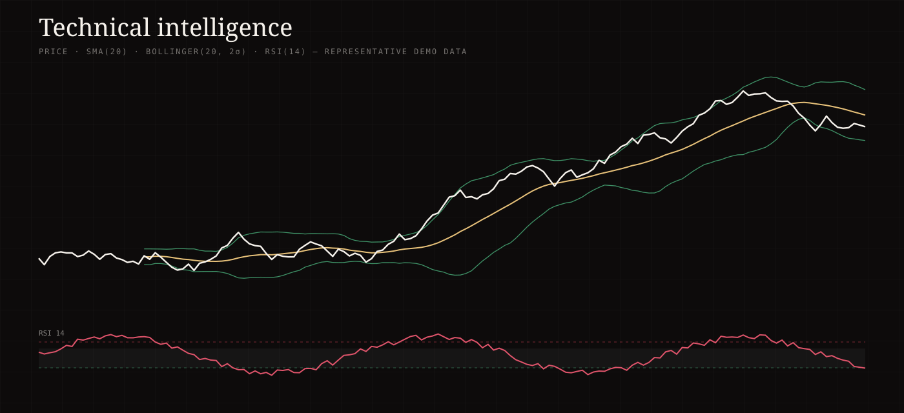
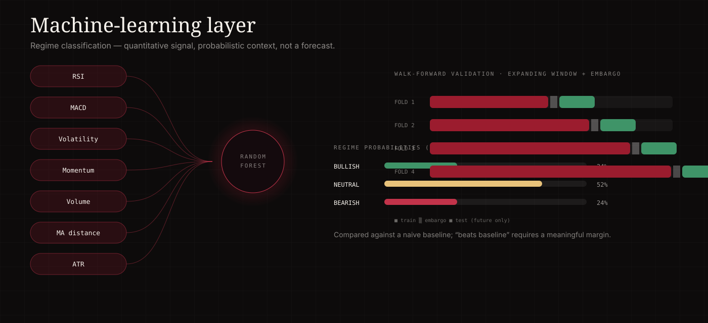
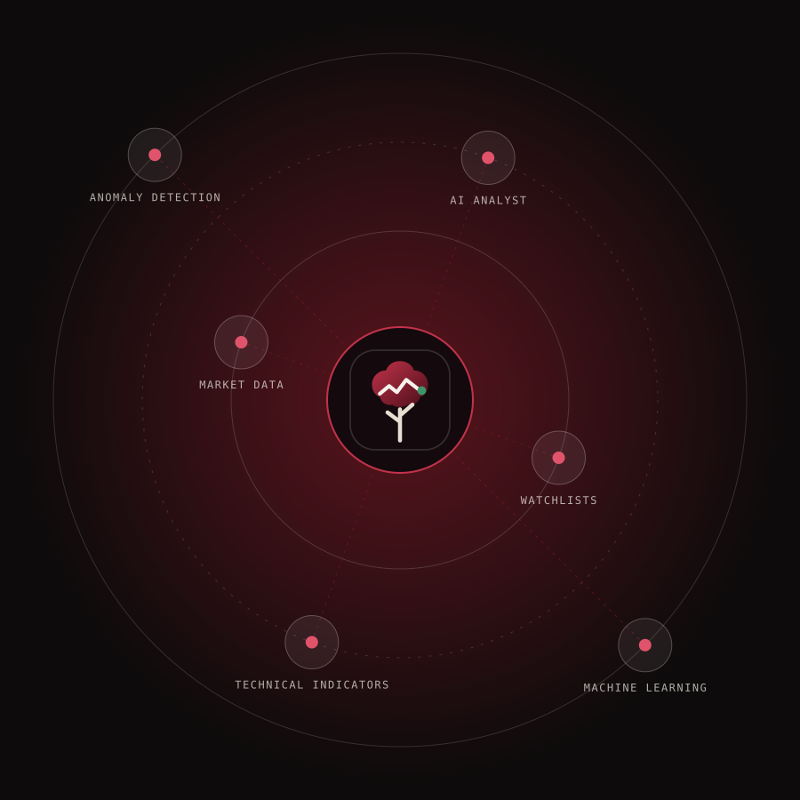
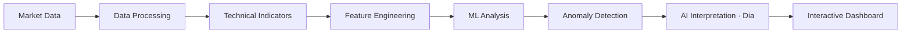
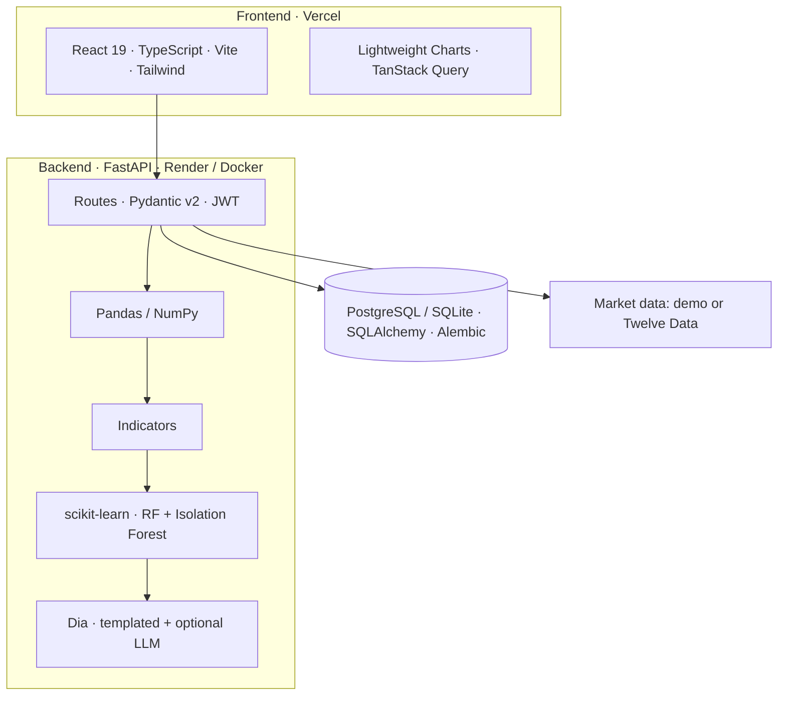
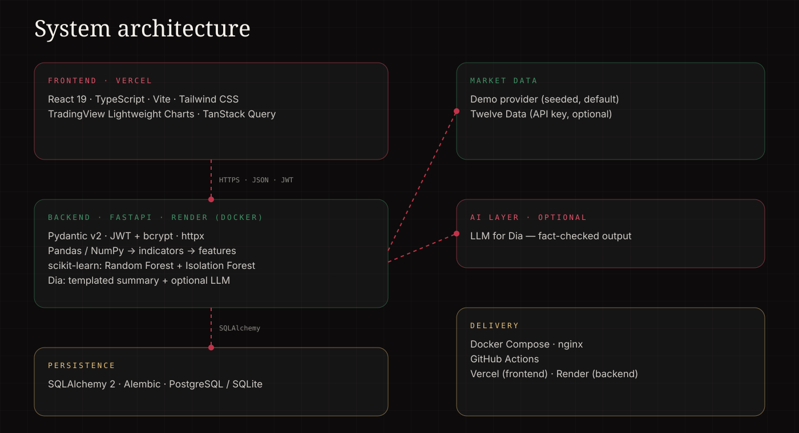
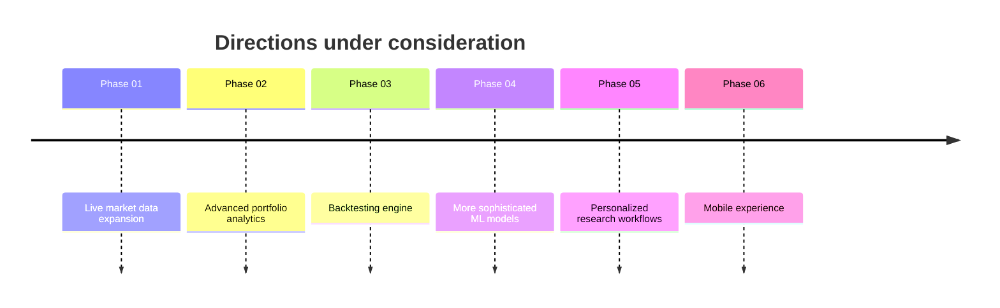

# 🌳 RedOak Markets — Case Study

<p align="center">
  
</p>

<p align="center">
  <b>See the market. Understand the trend.</b><br/>
  An interactive product, engineering and AI/ML case study.
</p>

<p align="center">
  
  
  
  
  
  
</p>

> **This repository is the case-study website — not the application.**
> The RedOak Markets application lives in a separate repository:
> **[Divyanshi12coder/redoak-markets](https://github.com/Divyanshi12coder/redoak-markets)** · [Live demo](https://redoak-markets-kappa.vercel.app)

**Live case study:** _add your deployed URL here once published_ (e.g. Vercel / GitHub Pages)

---

## What is this?

RedOak Markets is an educational stock-analysis platform that combines technical indicators, machine-learning regime classification, anomaly detection and an AI analyst called **Dia**. This site tells the story behind it in twelve chapters: the problem, the idea, the product, the data layer, the quantitative engine, the ML layer, Dia, architecture, engineering decisions, outcomes, lessons and roadmap.

It is built like a product presentation: an interactive orbiter of the system's layers, a toggleable indicator chart, an anomaly explorer, a regime classifier, a dashboard mockup and scroll-driven architecture diagrams.

### Honesty first

- Every chart in this site uses **seeded, synthetic, representative data** and is labelled as such. Nothing is live.
- Facts about the application (model parameters, security features, stack) come from the application's README.
- Outcomes are **qualitative** — production usage metrics are not publicly available.
- Roadmap items are labelled **planned · not built**.

## Screenshots

| Dashboard | Technical intelligence |
| --- | --- |
|  |  |

| ML layer | Orbiter | Mobile |
| --- | --- | --- |
|  |  |  |

> The visuals in `public/assets` are generated SVGs (`npm run assets`) built from seeded demo data — not stock photos and not live market data.

## The problem

Markets generate data faster than people can interpret it: too much data, fragmented indicators, difficult technical analysis, noisy signals, hard-to-interpret patterns and little personal context.

## The solution

One pipeline from raw bars to readable insight, with quantitative signals kept strictly separate from AI interpretation.



## Features of the case-study site

- **Hero** with an animated market scene: glowing price line, candlesticks, moving data point, ticker strip
- **Market-intelligence orbiter** — six orbiting layers; hover or focus pauses the orbit, lights the connection and reveals a glass card (Framer Motion)
- **Problem → convergence** animation and a scroll-drawn **solution pipeline**
- **Technical-intelligence chart** — toggle SMA, EMA, RSI, MACD, Bollinger Bands and ATR; the chart highlights the relevant region and explains it; hover for exact values
- **Anomaly explorer** — rolling z-scores computed live on the demo series; hover or focus a flagged point
- **ML section** — walk-forward validation animation, regime classifier and feature importance (Recharts, lazy-loaded)
- **Meet Dia** — abstract analyst visual with illustrative insight cards and a required disclaimer
- **Dashboard mockup** — watchlist, search, candlesticks, regime, anomalies and insight; clicking a stock re-renders the chart
- **Watchlist**, **system architecture**, **ten-stage data flow**, **security/reliability** (each item labelled *implemented* or *design consideration*), **responsive frames**, **engineering decisions**, **results**, **lessons** and an interactive **roadmap**
- Accessibility: semantic landmarks, skip link, keyboard-operable controls, visible focus, ARIA state, `prefers-reduced-motion` support

## Technology stack

| Area | Choice |
| --- | --- |
| Framework | React 19 + TypeScript (strict) + Vite |
| Styling | Tailwind CSS 3 with a custom crimson / wine / forest palette |
| Motion | Framer Motion (`useReducedMotion` everywhere) |
| Charts | Hand-built SVG for indicator/anomaly/candle charts; Recharts for feature importance |
| Icons | Lucide React (plus an inline GitHub mark) |

## System architecture (the application)





## AI / ML approach

- **Features:** 22 scale-free, causal indicators — no look-ahead.
- **Target:** next-10-session return versus a volatility-scaled threshold → bullish / neutral / bearish.
- **Model:** Random Forest (150 trees, depth 5, balanced class weights) per stock.
- **Validation:** expanding-window walk-forward folds with an embargo gap; compared against a naive baseline.
- **Anomalies:** rolling z-scores plus Isolation Forest.
- **Dia:** structured facts → templated summary, with an optional LLM whose output is rejected if it invents numbers or predictions.

The case study uses the language of *regime classification*, *quantitative signal* and *probabilistic context*. It never claims the model predicts the future.

## Design system

| Token | Value | Use |
| --- | --- | --- |
| Crimson | `#9b1c2e` / `#c2334a` | Primary accent, signals |
| Wine / burgundy | `#4a0e1a` / `#2a0a10` | Depth, dark panels |
| Forest | `#1f5a3d` / `#3f9468` | Data, growth |
| Ink / charcoal | `#0d0b0b` / `#1a1717` | Dark surfaces |
| Bone | `#f6f2ec` | Light surfaces, text |

Typography: Fraunces (display), Inter (UI), JetBrains Mono (data). Subtle glass panels, thin borders, grain, and a financial grid.

## Engineering decisions

1. **FastAPI** — typed validation, async I/O, OpenAPI contract.
2. **React + TypeScript** — type-safe, state-heavy financial UI.
3. **Technical indicators** — transparent, testable, a basis for features.
4. **Time-aware validation** — no future leakage; honest baselines.
5. **Anomaly detection** — flag unusual behaviour without claiming causes.
6. **Separate AI from signals** — Dia explains evidence; it never replaces it.

## Lessons learned

Financial data needs careful validation · indicators are context, not guarantees · time-aware ML validation matters · UX carries complex financial information · AI should interpret evidence, not replace it · demo/fallback modes improve reliability.

## Roadmap _(planned — not implemented)_



## Getting started

```bash
npm install
npm run dev        # local dev server
npm run build      # type-check + production build
npm run preview    # serve the production build
npm run assets     # regenerate README SVG visuals
```

## Project structure

```
src/
├── components/
│   ├── navigation/   sticky nav, active-section indicator, mobile menu
│   ├── hero/         hero + animated market backdrop
│   ├── orbiter/      interactive market-intelligence orbiter
│   ├── charts/       indicator, anomaly, candle, sparkline, feature importance
│   ├── architecture/ scroll pipeline, system diagram, data flow
│   ├── sections/     one component per chapter
│   └── ui/           logo, buttons, cards, reveal, tags, backdrops
├── data/             content, seeded market series, demo stocks
├── hooks/            active section, pointer glow, element width, in-view
├── pages/Home.tsx
├── styles/index.css
├── App.tsx
└── main.tsx
```

## Disclaimer

> RedOak Markets is an educational and analytical software project. Market signals and AI-generated insights are informational only and are not financial advice, investment recommendations, or guarantees of future performance.

## Author

**Built & Created By Divyanshi**
Full-Stack Developer • AI/ML Enthusiast • Product Builder
